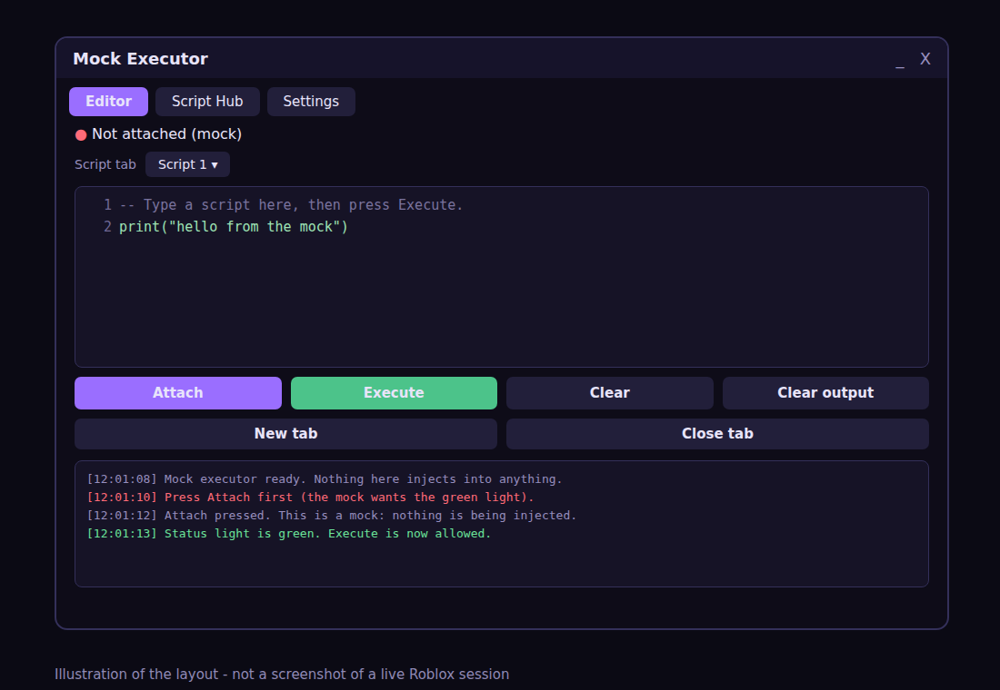

# Polaris 3.0 Guide

Polaris builds script library UIs, deep-research UIs and Roblox hubs, and since version 3 almost any other interface too: layouts, tables, charts, forms, saved state, plugins and apps described in words. You can start with one line and no coding.

Watch the tour first: [docs/video/polaris-tour.mp4](docs/video/polaris-tour.mp4) (52 seconds, captions only, no sound). The slides in it are drawings of the layout, not screenshots of a live Roblox session. It was made for version 2 and shows five launcher tiles. Version 3 has a sixth, Make Anything.

Contents: [Quick start](#quick-start-for-everyone) - [Toddler mode](#toddler-mode) - [Make your own hub](#make-your-own-script-hub-blocks-and-scripts) - [Script hub](#the-script-hub) - [Mock executor](#mock-executor-window) - [Script library](#script-library-ui) - [Deep research](#deep-research-ui) - [Roblox hub](#roblox-hub) - [Say what you want](#say-what-you-want) - [Plain-table hubs](#plain-table-hubs) - [Builder](#builder) - [Create anything (v3)](#create-anything-v3) - [Elements](#all-elements) - [Research providers](#research-providers) - [Troubleshooting](#troubleshooting) - [Capabilities and limits](#capabilities-and-limits)

## Quick start for everyone

Paste this one line into your executor and run it.

```lua
loadstring(game:HttpGet("https://raw.githubusercontent.com/HomekidChud/Polaris/main/Polaris.luau"))().Start()
```

A screen of five big tiles and one wide pink button opens. Tap one.

| Tap | What opens |
|---|---|
| Script Hub | A working script hub with ready-made scripts, search, favourites and a + Add button for your own |
| Research | A deep-research window (plan, sources, cited report) |
| Game Hub | Live stats, field of view, time of day, output log |
| Everything | Home, Scripts and Research tabs in one window |
| Play | One giant button that makes confetti. Nothing can go wrong |
| Create your own script hub (wide button) | The block editor, already filled with a working hub you can change |

Press RightShift to hide or show any Polaris window. On touch screens a floating "P" button does the same.

If you only want the library, without the launcher, use the same line without `.Start()` and keep the result:

```lua
local Polaris = loadstring(game:HttpGet("https://raw.githubusercontent.com/HomekidChud/Polaris/main/Polaris.luau"))()
```

## Toddler mode

The launcher is made for small hands.

- Tiles are at least 64 pixels tall and wide on any screen.
- Almost no reading is needed. Each tile has a picture and one word.
- Every tap makes confetti. The Play tile is a single huge button with a counter.
- A tile that fails shows a friendly "Oops" note and never crashes the screen.

Open it directly: `Polaris.Start()` for the tiles, `Polaris.Toy()` for just the big button.

Change it:

```lua
Polaris.Start({
	Title = "Kai's Games",         -- rainbow title
	Subtitle = "Tap a picture!",
	Theme = "Midnight",
	Keep = true,                   -- leave the tiles open after a tap
	MakeHub = false,               -- hide the wide "Create your own script hub" button
	Tiles = {
		{ Name = "Hello", Icon = "rainbow", Color = Color3.fromRGB(255, 120, 80), Action = function() print("hi") end },
		{ Name = "Scripts", Icon = "list", Action = function() Polaris.Templates.ScriptLibrary() end },
	},
})
```

Icons you can use: `list`, `search`, `grid`, `plus`, `rainbow`, `dots`. They are drawn from plain boxes, so they need no images or emoji fonts.

## Make your own script hub: blocks and scripts

Tap the wide pink button, "Create your own script hub". The block editor opens with the My Script Hub template already loaded, so there is a working hub on screen from the first second.

Two kinds of building block work together:

| Kind | What it is | Example |
|---|---|---|
| Blocks | Pieces of the window: Label, Section, Toggle, Slider, Dropdown, Stats, Progress, Console, Script Library, Research | A title, a stats strip |
| Script blocks | A button that holds your own Luau code and runs it when tapped | `workspace.CurrentCamera.FieldOfView = 100` |

How to use it:

1. Tap a block in the left list to add it. Tap a block on the canvas to edit it on the right.
2. For a Script block, type a name and write your code in the tall code box. Code runs inside a safe wrapper, so a mistake shows a red note instead of breaking the hub.
3. Add a Script Library block to list scripts that live at a web link. Type one per line as `Name | description | https://link`.
4. Press Preview to try it. The preview shows Script buttons but does not run their code.
5. Press Export for a ready script. It loads Polaris, builds your hub, and contains your code. Share that script as your own hub.

The editor checks your code before export where the place allows it. If a Script block has a mistake it tells you which one.

You can open the same editor from the Settings tab of any Polaris window, from the Home tab of the Roblox hub, or with `Polaris.MakeHub()`. `Polaris.MakeHub("Script Library")` starts from another template instead.

## The script hub

The Script Hub tile opens a real hub. These scripts are built in. They only change your own camera, lighting and screen, or show information:

| Script | What it does |
|---|---|
| Fullbright | Brightens a dark game. Run again to undo |
| Wide view | Field of view 100. Run again for normal |
| Day or night | Flips your sky between midday and midnight |
| FPS counter | A small frames-per-second number. Run again to hide |
| Server info | Place id, player count, server id |
| Copy game link | Copies the game's Roblox page link |
| Hide chat | Hides or shows chat |
| Rejoin this server | Leaves and joins the same server again |

They are plain Luau functions, so they do not need `loadstring` or HTTP. They have not been tried in a real Roblox client.

### Add your own scripts

Tap + Add. Type a name, then either paste a link that starts with https:// or paste code. Tap Add it. Your script appears with a "mine" tag and a remove button, and it is saved for next time when the executor can write files. Code you paste runs through `loadstring`, so it needs a place that allows it.

In code: `library:AddUser("Name", "https://link or Luau code")`.

## Mock executor window

`Polaris.MockExecutor()` opens an executor-style window: an Attach button with a status light, a script editor with line numbers and up to eight script tabs, an Execute button, an output console, a Script Hub tab and a Settings tab. It is a mock-up. It is built only from ordinary Polaris elements and it does not attach to Roblox, bypass anything or inject anything.



```lua
local Polaris = loadstring(game:HttpGet("https://raw.githubusercontent.com/HomekidChud/Polaris/main/Polaris.luau"))()
local mock = Polaris.MockExecutor({ Name = "My Mock" })
```

What each part really does:

| Part | Mock mode (default) | Live mode (`Live = true` or the Settings toggle) |
|---|---|---|
| Attach | Turns a pretend status light green after a moment. | Same. It never attaches to anything. |
| Execute | Needs the green light. Checks the text for mistakes where `loadstring` exists, then prints what it would do. It does not run the text. | Runs the text with `loadstring`, or with your own `Run = function(code) ... end` handler. Errors are printed in the output. |
| Script tabs | Up to eight tabs. Switching keeps each tab's text. | Same. |
| Script Hub tab | The eight harmless hub scripts plus + Add. Tapping one does run it. | Same. |

Options: `Name`, `Size` (a Vector2), `Live`, `Run`, `Scripts`, `Folder`, `Theme`, `Code`. The returned table has `:Attach()`, `:Detach()`, `:Execute()`, `:SetCode(text)`, `:GetCode()`, `:NewTab()`, `:CloseTab()`, `:SetLive(true)`, `:Log(text, kind)`, plus `.Window`, `.Editor` and `.Console`.

Live mode needs `loadstring`, which only exists where an executor (or an enabled setting in Studio) already provides it. The mock cannot give you one. Polaris is the screen, not the engine underneath.

The same editor is available in any window as `tab:CreateCodeEditor({ Default = "...", Height = 220, Callback = function(text) end })`.

## Script library UI

A window with a search box, tag chips, Favourites, This game, and a card for every script.

```lua
local window, library = Polaris.Templates.ScriptLibrary({
	Name = "My Scripts",
	Scripts = {
		{ Name = "Hello", Description = "Says hello", Tags = { "fun" }, Run = function() print("hello") end },
		{ Name = "Remote tool", Url = "https://raw.githubusercontent.com/you/repo/main/tool.lua", Tags = { "tools" } },
	},
	TrustedHosts = { "raw.githubusercontent.com" },
})
```

A script can have one of three sources:

| Source | Field | Notes |
|---|---|---|
| A Luau function | `Run` | Always works. Safest. |
| A web address | `Url` | Needs HTTP access and `loadstring`. Asks you to confirm first. |
| Code in a string | `Code` | Needs `loadstring`. |

Other fields: `Id`, `Author`, `Version`, `Icon`, `Games` (a list of place ids, used by the This game filter).

### Load a whole list from one file

Host a JSON file like this and point the library at it.

```json
{ "scripts": [
	{ "Name": "Hello", "Url": "https://example.com/hello.lua", "Description": "Says hello", "Tags": ["fun"] }
] }
```

```lua
Polaris.Templates.ScriptLibrary({ Manifest = "https://example.com/scripts.json" })
```

Manifest entries can only be Url or Code scripts. A manifest can never contain a function.

### Safety rules built in

- Remote scripts ask for confirmation before they run (`Confirm = false` turns that off).
- `TrustedHosts` blocks any address whose host is not on the list.
- A script that fails to download, compile or run shows a message and the window keeps working.
- Favourites and run counts are saved when the executor offers file functions.

### Use the library in code

```lua
library:Add({ Name = "New", Run = function() end })
library:AddMany({ ... })
library:Remove("new")
library:Query({ Text = "hello", Tag = "fun" })   -- search without the UI
library:Favourite("hello", true)
library:Run("hello")                             -- returns true, or false and a message
library:On("run", function(entry) print("ran", entry.Name) end)
library:Export()                                 -- JSON text
```

## Deep research UI

A question box, a depth picker (Quick, Standard, Deep), a live plan with progress, a report with numbered sources, and Copy and Save buttons.

```lua
Polaris.Templates.DeepResearch({ Provider = "Demo" })
```

Pick where the answers come from with `Provider`:

| Provider | Needs | Result |
|---|---|---|
| `"Demo"` | Nothing | Placeholder text that shows how the UI behaves. Not real research. |
| `"Perplexity"` | Your own Perplexity API key and HTTP access | A cited report from the Perplexity Agent API |
| `"HTTP"` | Your own server and HTTP access | Whatever your server returns |
| A function | Nothing | You write it. See below. |

### Perplexity provider

The window shows a masked key box. Paste your key there. It lives in memory only, is hidden after you enter it, and is never written to a file or into exported scripts. Depths map to the API effort levels: Quick is fast, Standard is medium, Deep is high, Max is xhigh. See the Perplexity docs on [effort](https://docs.perplexity.ai/docs/agent-api/effort.md) and [background mode](https://docs.perplexity.ai/docs/agent-api/background-mode.md).

```lua
Polaris.Templates.DeepResearch({ Provider = "Perplexity" })
```

The provider submits a background request to `POST /v1/agent`, polls `GET /v1/agent/{id}`, and reads the message text and search results. It is written to the [API reference](https://docs.perplexity.ai/api-reference/agent-post.md) and has not been run against the live service.

A client should not ship a key to players. For anything public, use the HTTP provider with your own server that holds the key.

### HTTP provider

```lua
Polaris.Templates.DeepResearch({
	Provider = Polaris.Research.Providers.HTTP({
		Url = "https://your-server.example/research",
		Headers = { ["X-Token"] = "..." },
	}),
})
```

By default it sends `{ query, depth, effort }` as JSON. Use `BuildBody` to change the request and `Parse` to turn the response into text and sources.

### Write your own provider

```lua
Polaris.Templates.DeepResearch({
	Provider = function(ctx)
		ctx:SetPlan({ "Think", "Write" })
		ctx:Step(1, "running")
		ctx:Source({ Title = "My notes", Url = "https://example.com" })
		ctx:Step(1, "done")
		ctx:Step(2, "running")
		ctx:Text("The answer to " .. ctx.Query .. " is 42 [1].")
		ctx:Done()
	end,
})
```

Context members: `ctx.Query`, `ctx.Depth`, `ctx:SetPlan`, `ctx:AddStep`, `ctx:Step`, `ctx:Source`, `ctx:Text` (append), `ctx:SetText` (replace), `ctx:Log`, `ctx:Wait`, `ctx:IsCancelled`, `ctx:Done`, `ctx:Fail("message")`.

### Use the engine without the UI

```lua
local session = Polaris.Research.new({ Provider = "Demo" })
session:On("done", function(state) print(state.Report) end)
session:Run("How do tides work?", { Depth = "Quick" })
-- later: session:GetReport(), session:ExportMarkdown(), session:Cancel()
```

## Roblox hub

```lua
Polaris.Templates.RobloxHub({
	Name = "My Hub",
	Buttons = { ["Say hi"] = function() print("hi") end },
	Toggles = { ["Cool mode"] = function(on) print(on) end },
	Sliders = { Speed = { Min = 0, Max = 100, Default = 16 } },
	Stats = { "FPS", "Ping", "Players", "Memory" },
})
```

It returns the window and a table with `Tabs`, `Library` and `Research`.

It creates a Home tab (welcome, game name, live stats), a Features tab for your own controls, a Scripts tab (a few example scripts unless you pass your own with `Scripts`, `Library` or `Manifest`), an optional Research tab (`Research = true`), a Tools tab, and a Settings tab (theme picker, save and load buttons, hide button).

The Tools tab holds safe developer helpers: a field of view slider, a local time of day slider, and a live output log that shows the game's own messages. Stats can be `FPS`, `Ping`, `Players`, `Memory`, `Time`, `Server`, or your own `{ Name = "Coins", Get = function() return 5 end }`.

Polaris does not include cheats or exploit features. It only changes your own camera and lighting.

## Say what you want

```lua
Polaris.Make("a research tool")      -- opens the research UI
Polaris.Make("my script list")       -- opens the script library
Polaris.Make("roblox hub")           -- opens the hub
Polaris.Make("let me design my own") -- opens the Builder
Polaris.Make("banana")               -- anything unclear opens the Everything window
```

`Polaris.Classify("words")` returns the name it would pick, which is handy for testing. It is simple keyword matching and not artificial intelligence.

## Plain-table hubs

Describe a window with plain tables and get a working UI back.

```lua
local window, made = Polaris.Hub({
	Name = "Kai's Hub",
	Theme = "Midnight",
	Text = "Welcome!",
	Buttons = { Wave = function() print("wave") end },
	Toggles = { Sparkle = function(on) print(on) end },
	Sliders = { Speed = { Min = 0, Max = 10, Default = 3 } },
	Dropdowns = { Colour = { Options = { "Red", "Blue" } } },
	Inputs = { Name = function(text) print(text) end },
	Scripts = { { Name = "Hi", Run = function() print("hi") end } },
	Research = true,
})
```

Rules that keep it simple:

- A dictionary is shown sorted by name. To control order, use a list of pairs: `Buttons = { { "First", fn }, { "Second", fn } }`.
- A function value becomes the callback. A table value is the full element config.
- `Scripts` or `Library` adds a Scripts tab. `Research` adds a Research tab. `Settings = false` removes the Settings tab.
- Extra tabs: `Tabs = { Fun = { Buttons = { ... } } }`.
- A wrong theme name falls back to Default and prints a warning. It does not crash.

One-button version: `Polaris.Quick("Title", { "Say hi", function() print("hi") end })`.

## Builder

```lua
Polaris.Builder:Open()
-- or: loadstring(game:HttpGet("https://raw.githubusercontent.com/HomekidChud/Polaris/main/Builder.luau"))()
```

Tap a block on the left to add it. Tap a block on the canvas to edit it on the right. Preview shows it live. Export gives a ready script. The pink button on the launcher opens this editor with a working hub already loaded.

New in 2.0:

- Blocks: Script (your own code), Label, Progress, Console, Stats, Script Library and Research, next to the originals.
- Templates: My Script Hub, Script Library, Deep Research, Roblox Hub and Everything, as buttons in the window properties panel.
- A Script Library block takes lines like `Name | description | https://url ; Next | description | https://url`. Links must be https.
- A Research block exports no API key. Players paste their own at run time.
- Open a project without code: `Polaris.FromProject(jsonText, { ["Button name"] = function() end })`.

Builder members: `Polaris.MakeHub()` (open with a template), `Open`, `Close`, `Generate`, `ExportJSON`, `ImportJSON`, `GetProject`, `SetProject`, `NewProject`, `OpenPreview`, `ClosePreview`, `GetTemplateNames`, `LoadTemplate(name)`, `AddBlock(kind)`, `AddTab(name)`. The full older reference is in [docs/API.md](docs/API.md).

## All elements

Every element works the same way: `tab:CreateX({ ... })`, or `tab:Add("X", { ... })`, and they share `:Get()`, `:Set(value, silent)`, `:SetVisible()`, `:SetDisabled()` and `:Destroy()` where that makes sense. The new display elements ignore `:Set` when it has no meaning for them.

| Element | Main options |
|---|---|
| Section, Divider, Paragraph | `Name` or `Text` |
| Button | `Name`, `Callback` (optional) |
| Toggle | `Name`, `Default`, `Flag`, `Callback` |
| Slider | `Name`, `Min`, `Max`, `Default`, `Increment`, `ValueName`, `Flag`, `Callback` |
| Dropdown | `Name`, `Options`, `Default`, `Multiple`, `Flag`, `Callback` |
| ColorPicker, Keybind, Textbox | see [docs/API.md](docs/API.md) |
| Label (new) | `Text`, `Size`, `Bold`, `Color`; `:SetText()` |
| Progress (new) | `Name`, `Max`, `Value`, `Color`; `:Set(n)` |
| Console (new) | `Name`, `Height`, `MaxLines`; `:Log(text)`, `:Clear()` |
| ButtonRow (new) | `Buttons = { { Name, Callback }, ... }` |
| CodeEditor (new) | `Name`, `Default`, `Height`, `Placeholder`, `LineNumbers`, `Callback`; `:Get()`, `:Set(text)`, `:Clear()` |
| Stats (new) | `Items`, `Columns`, `Interval` |
| ScriptLibrary (new) | `Scripts`, `Library`, `Manifest`, `TrustedHosts`, `Confirm`, `Folder`, `Height`, `OnRun` |
| Research (new) | `Provider`, `Depth`, `Depths`, `Height`, `Session` |
| Group (v3) | `Name`, `Card`, `Collapsible`, `Open`; it is also a tab |
| Columns, Pages (v3) | `Count`, `Gap`; `Names`, `Default`, `Callback` |
| Spacer, Image, Custom (v3) | `Height`; `Image`, `Fit`, `Caption`; `Build(frame, ctx)` |
| Table, Chart, Form (v3) | see Create anything |

`Height = "Fill"` makes a big widget fill the rest of the tab.

Window helpers: `window:GetTab(name)`, `window:SelectTab(name)`, `window:Dialog({ ... })`, `window:AddSettingsTab()`.

Themes: Default, Midnight and Light, or your own with `Polaris:AddTheme(name, colors)`. `Polaris.Font` sets the font for all new text.

## Research providers

See [Deep research UI](#deep-research-ui). A summary of what is verified:

| Provider | Verified how |
|---|---|
| Demo | Automated tests |
| Perplexity | Request and reply handling tested against sample responses. Not run against the live API |
| HTTP | Automated tests against a fake server |
| Function | Automated tests |

## Troubleshooting

| You see | Cause and fix |
|---|---|
| Nothing appears | Your executor may block `loadstring` or HTTP. Test with `print(pcall(function() return game:HttpGet("https://example.com") end))`. |
| "This place cannot make HTTP requests" | Normal Roblox clients block it. Use an executor that provides `request`, or run research from a server with HttpService enabled. |
| "This place does not allow loadstring" | Studio LocalScripts and most live games disable it. Use `Run` functions instead of `Url` scripts. |
| "Blocked: host is not in TrustedHosts" | Add the host to `TrustedHosts`, or remove the list. |
| Research shows placeholder text | You are on the Demo provider. Switch to `Perplexity` or `HTTP`. |
| Perplexity says the key was rejected | The key is wrong or has no credit. Paste it again. |
| Copy does nothing | No `setclipboard` function. Select the text and copy it by hand. |
| A window is gone | Press RightShift, or tap the floating P. |
| Text looks odd | The new default font is Gotham and has not been visually checked. Set `Polaris.Font = Enum.Font.SourceSans` before creating windows. |

## Create anything (v3)

Version 3 turns Polaris from a set of ready-made UIs into a kit you can build almost any interface from. The loadstring line did not change. There are four new layers, and each one works on its own.

| Layer | What it gives you |
|---|---|
| Layout | Group, Card, Accordion, Columns, Pages, Spacer, Image, Custom |
| Data | Table, Chart, Form, CodeEditor |
| State and plugins | State, Computed, Storage, Bind, Link, DefineElement, DefineBlock, Use |
| Say it | A safe JSON spec, `Polaris.Imagine("...")` and the Make Anything tile |

### Layout

```lua
local Window = Polaris:CreateWindow({ Name = "Layouts" })
local tab = Window:CreateTab({ Name = "Home" })

local card = tab:CreateGroup({ Name = "Player", Card = true })          -- a boxed group
card:CreateLabel({ Text = "Hello" })

local more = tab:CreateGroup({ Name = "More", Collapsible = true, Open = false })  -- an accordion
more:CreateToggle({ Name = "Extra", Default = true })

local cols = tab:CreateColumns({ Count = 2 })                           -- cols[1], cols[2] are groups
cols[1]:CreateButton({ Name = "Left" })
cols[2]:CreateButton({ Name = "Right" })

local pages = tab:CreatePages({ Names = { "One", "Two" }, Default = "One" })
pages.Pages.Two:CreateLabel({ Text = "Second page" })
pages:Select("Two")

tab:CreateSpacer({ Height = 8 })
tab:CreateImage({ Image = "rbxassetid://123456", Height = 100, Caption = "Logo" })
```

A group is also a tab, so everything you can put on a tab fits inside a group, a column or a page, and groups nest.

Custom draws anything with plain Roblox instances and still sits in the layout:

```lua
tab:CreateCustom({ Height = 60, Build = function(frame, ctx)
	local box = ctx.Create("Frame", { Size = UDim2.new(1, 0, 1, 0), BackgroundColor3 = ctx.Theme().Accent, Parent = frame })
end })
```

`ctx` has `Frame`, `Window`, `Create`, `Kit`, `Polaris`, `Theme()` and `SetHeight(n)`. If your function errors, the box shows the message instead of breaking the window.

### Data

```lua
local table1 = tab:CreateTable({ Columns = { "Name", "Score" }, Rows = { { "Ada", 92 }, { "Bo", 85 } },
	Sortable = true, Search = true, Height = 180 })
table1:AddRow({ "Cy", 77 })
print(table1:Count(), table1:GetRows()[1][1])

tab:CreateChart({ Type = "bar", Title = "Week", Labels = { "Mon", "Tue", "Wed" }, Values = { 4, 7, 5 } })
local live = tab:CreateChart({ Type = "line", Title = "FPS", MaxPoints = 30 })
live:AddPoint(60)

tab:CreateForm({ Name = "New player", Fields = {
	{ Name = "Player", Type = "Textbox", Required = true },
	{ Name = "Score", Type = "Slider", Min = 0, Max = 100, Default = 50 },
}, Submit = "Add", Callback = function(values) table1:AddRow({ values.Player, values.Score }) end })
```

Table methods: `SetRows`, `AddRow`, `RemoveRow`, `Clear`, `GetRows`, `Count`, `GetSelected`, `Sort`, `SetFilter`, `GetView`. Chart methods: `SetData`, `SetSeries`, `AddPoint`. A form has `GetValues`, `SetValues`, `Reset`, `Validate` and `Submit`.

### State, saving and plugins

```lua
local score = Polaris.State(0, { Persist = true, Folder = "MyGame" })   -- saved between sessions where files exist
local label = tab:CreateLabel({ Text = "Score: 0" })
label:Bind(score, function(v) return "Score: " .. v end)               -- label follows the state
score:Update(function(v) return v + 1 end)

local slider = tab:CreateSlider({ Name = "Volume", Min = 0, Max = 10, Default = 5 })
local volume = Polaris.State(5)
slider:Link(volume)                                                      -- two-way

local double = Polaris.Computed({ score }, function(s) return s * 2 end)
```

State has `Get`, `Set`, `Update`, `Subscribe`, `Map` and `Destroy`. `Polaris.Storage(folder)` is the same save box on its own: `Get`, `Set`, `Delete`, `Keys`, `IsPersistent`. Without file functions it keeps values in memory for the session.

Make your own element type, share a bundle of them, or add a block to the Builder:

```lua
Polaris.DefineElement("Badge", {
	Height = 28,
	Default = "New",
	Build = function(frame, config, element, ctx) ... end,   -- draw it
	Set = function(self, value) ... end,
})
tab:CreateBadge({ Text = "Hot" })   -- also works as tab:Add("Badge", {...})

Polaris.Use(function(P) P.DefineElement("Another", { ... }) end)   -- a plugin is a function or a table of the same helpers
Polaris.DefineBlock("Banner", { Label = "Banner", new = ..., emit = ..., apply = ..., item = ..., props = ... })
```

You cannot override a built-in element name. Look at `src/modules/08_builder_kinds.luau` for complete block examples (Table, Chart and Image are good small ones).

### Spec: a whole app as safe JSON

A spec is plain data. It is the one format that people, the Builder and an AI can all hand to Polaris without running anything.

```lua
local app = Polaris.Spec.Build({
	Name = "Clicker",
	State = { count = 0 },
	Tabs = { { Name = "Play", Items = {
		{ Type = "Label", Text = "Clicks: {count}" },
		{ Type = "Progress", Name = "Goal", Max = 10, Key = "count" },
		{ Type = "Button", Name = "Click me", Action = { Do = "Add", Key = "count", Value = 1 } },
		{ Type = "Button", Name = "Reset", Action = { Do = "Reset", Key = "count" } },
	} } },
})
print(app.Problems) -- anything that was dropped, with the reason
```

The app gives you `Window`, `States`, `Tabs`, `Ids`, `Elements`, `Problems`, `GetState`, `SetState`, `ToJSON`, `Destroy` and `RunAction`. `{key}` inside a label shows a state value. A keyed input (for example a Toggle with `Key = "sound"`) links to that state automatically.

Item types: Button, Chart, Columns, Dropdown, Form, Group, HubScripts, Image, Label, Pages, Progress, Section, Slider, Spacer, Stats, Table, Textbox and Toggle. Run `print(Polaris.Spec.Describe())` for the exact list with every option.

Safe actions: Notify, Set, Add, Toggle, Reset, Copy, Goto, Theme, Run (only the built-in hub script names), AddRow, ClearTable, and any action you register in `Polaris.Actions`. A list of actions runs in order. A spec can never hold code, links or function text: `Spec.Validate` removes them and lists each in `Problems`. Limits: 12 tabs, 250 items, 4 levels deep, 2000 characters per text. To add behaviour a spec cannot express, register your own action first:

```lua
Polaris.Actions.Ping = function(args, ctx) print("pong", args.Who) end
-- { Do = "Ping", Args = { Who = "me" } }
```

### Imagine: describe it, get it

```lua
Polaris.Imagine("a dashboard with a chart and a settings tab")       -- offline demo provider
Polaris.Imagine("a clicker game", { Provider = "Perplexity", ApiKey = "YOUR_KEY" })
local app, problems, spec = Polaris.Imagine("a tracker", { Build = false })   -- only validate, do not open
```

Tap the teal Make Anything tile in the launcher (or run `Polaris.Imaginer()`) to get a window with a prompt box, a provider dropdown, a key box, and the buttons Make it, Show spec, Copy spec and Close it. The Ideas tab has six example prompts.

How it stays safe: the provider must answer with a spec. Polaris cuts out any code fence or chatter, validates the spec against the whitelist above, and if something is wrong it asks once more with the problems listed. Nothing the AI writes is ever run as code. The Demo provider is plain keyword matching (counter, dashboard, tracker, settings, hub, about) and gives starter layouts. The Perplexity provider is written to the official API docs but has not been run against the live service. Your key stays in memory only.

### What this means by anything

You can now build any interface made from these parts, or from your own parts through Custom and DefineElement, and wire it with state and the safe actions. That covers hubs, dashboards, trackers, settings screens, forms, tools and small games with a clicker style loop. It still does not mean any program: Polaris draws UI inside Roblox. It does not run outside Roblox, does not write game logic for you beyond the safe action list, and cannot be an executor.

## Capabilities and limits

### It can

- Open a tile launcher, a working script hub, a research window, a Roblox hub, or a block editor for making your own hub from one line.
- Build any window from plain tables, from words, or from a Builder project.
- Search, tag, favourite, confirm and safely run scripts, from functions, code, URLs or a JSON manifest, and let players add their own with + Add.
- Mix blocks and scripts in the editor: Script blocks hold real Luau code, and the export is a standalone hub script.
- Run a plan, sources and cited report flow with a demo, Perplexity, HTTP or custom provider.
- Show live stats, a progress bar, a console and a field of view and time of day control.
- Switch themes live and save configs where files are available.
- Fit small screens and add a floating button on touch devices.
- Lay out cards, columns, pages and accordions, show tables, charts and forms, keep saved state, and add your own element types and Builder blocks.
- Turn a safe JSON spec, or a sentence, into a working window with `Polaris.Spec.Build` and `Polaris.Imagine`.

### It cannot, or has not been shown to

| Limit | Detail |
|---|---|
| Real Roblox rendering | Every automated test runs under Lune with a simulated Roblox. Layout, dragging, touch, gamepad and the confetti animation are unverified on a real device. |
| Networking | Needs an executor `request()` or HttpService on a server. |
| `loadstring` | Needs a host that allows it. |
| Files and clipboard | Need executor functions. Without them, saving falls back to memory for the session. |
| Live research | Perplexity provider untested against the live API. Answers are only as good as the provider. |
| Intent matching | `Polaris.Make` and the Demo Imagine provider are keyword matching. |
| Imagine with AI | The Perplexity path is untested against the live API, needs your own key, and can only produce a spec of safe actions, never code. |
| Layout, tables and charts | New in v3 and only tested under Lune with a simulated Roblox. Check them in Studio before shipping. |
| Anything | Anything means any UI from the element set, your own elements and raw instances. It does not mean any program. |
| Script block code | Runs with your executor's full permissions. The editor can only check it for mistakes where `loadstring` exists. The preview never runs it. |
| Security | Obfuscation deters casual copying and nothing more. Any script you load with the library runs with full permissions of your executor, so only add scripts you trust. |
| Executor exploits | Not included. `Polaris.MockExecutor()` is a mock-up window only: it does not attach to Roblox, inject or bypass anti-cheat, and Polaris cannot be turned into an executor, because an executor is native software outside Luau. |

## Rebuilding

```
python3 build/bundle.py     # core + modules -> src/Polaris.luau
bash tests/run_all.sh       # all tests on the readable bundle
bash build/build.sh         # bundle, test, obfuscate, test the published file
```

The tour video was made with [VideoCraft](https://homekidchud.github.io/artcraft-live/videocraft/), driven by `docs/video/make_video.py` from the slides in `docs/video/make_slides.py`, then converted to MP4 with ffmpeg.
